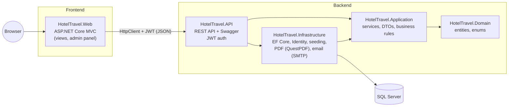
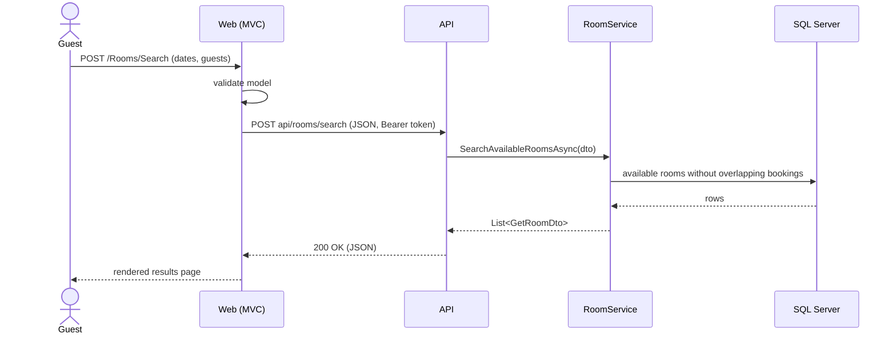
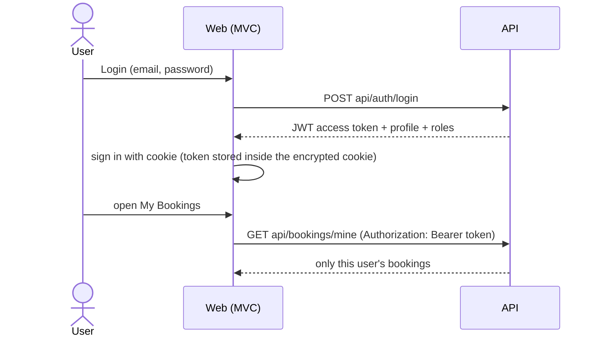
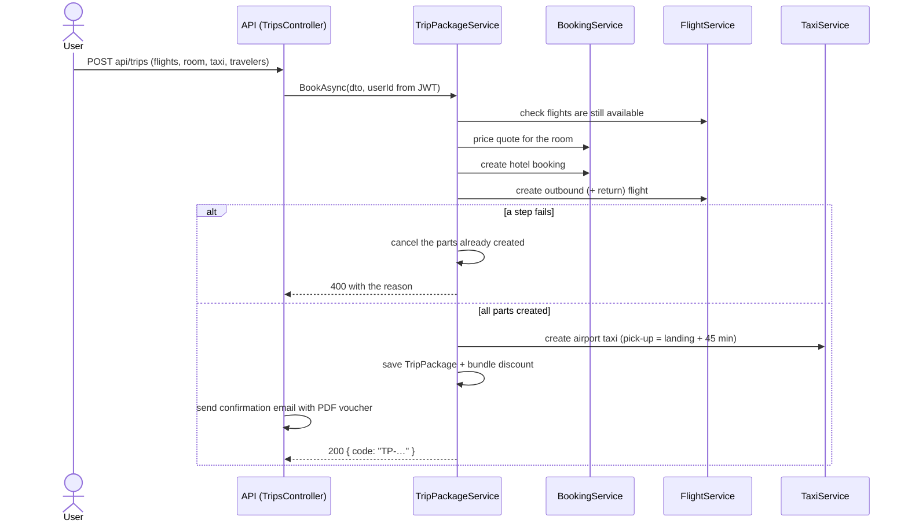

# Tripio — Hotel & Travel Reservation System

[](https://github.com/nigar-aligayeva-code/FinalProject/actions/workflows/ci.yml)


A full-stack booking platform built with **ASP.NET Core 8**: guests search and book hotel rooms,
rent cars, book airport taxis and flights — or all of them together as a **trip package** — find
hotels on a map, explore city attractions and manage everything from one **My Bookings** page. Guests get a
confirmation email with a **PDF voucher**. Admins manage the catalogue and follow the business in an
**analytics** dashboard.

> **Architecture (Variant B):** ASP.NET Core **Web API** backend · ASP.NET Core **MVC** frontend ·
> connected with **HttpClient** · **SQL Server** · documented with **Swagger**.

---

## Architecture

The solution follows **Clean Architecture**. Dependencies point inwards: the domain knows nothing
about the database, the web or the API.



| Project | Responsibility |
|---|---|
| **HotelTravel.Domain** | Entities (`Hotel`, `Room`, `Booking`, `FlightRoute`, `TripPackage`, `EmailLog`, …) and enums. No dependencies. |
| **HotelTravel.Application** | Business logic: services (`BookingService`, `FlightService`, `TripPackageService`, `AnalyticsService`, …), interfaces, DTOs and pure rule classes (`BookingRules`, `PricingCalculator`, `FlightRules`, `TaxiRules`, `TripPackageRules`, `AnalyticsCalculator`). |
| **HotelTravel.Infrastructure** | EF Core `AppDbContext`, migrations, ASP.NET Identity, transactional booking creation, seeders, PDF vouchers (QuestPDF + QR) and email delivery. `AddHotelTravelInfrastructure()` registers everything. |
| **HotelTravel.API** | REST endpoints (~110), JWT authentication, role-based authorization, global exception middleware, Swagger. **Owns the database.** |
| **HotelTravel.Web** | MVC frontend + admin area. **Has no database access**: every service interface is implemented by an HTTP client that calls the API. |
| **HotelTravel.Tests** | 140+ xUnit tests (rules + services with the EF Core InMemory provider), run on every push by GitHub Actions. |

### How a request flows (example: search rooms)



The MVC controllers depend on interfaces such as `IRoomService`. In the API those interfaces are
implemented by the real services (EF Core); in the MVC app they are implemented by
`RoomApiService`, `BookingApiService`, … which call the API through a shared `ApiClient`.
The controllers did not have to change when the data source moved behind the API.

### Authentication



* The API trusts **only the token**: the user id is taken from the JWT, never from the request body.
* Roles: `Admin` and `User`. Admin endpoints use `[Authorize(Roles = "Admin")]`.
* If the token expires, the MVC app signs the user out and redirects to the login page.

---

## Features

**Core (F1–F8)**

1. Hotel & room catalogue with photos, amenities and 360° panorama
2. Availability search by city, dates and guests (fully booked dates are disabled in the calendar)
3. Booking with an instant confirmation code
4. Find / modify / cancel a booking by code + email
5. Accounts (register / login) and **My Bookings**
6. Admin panel: hotels, chains, rooms (image upload), amenities, bookings
7. Booking status management + occupancy calendar
8. Concurrency-safe booking (serializable transaction + deadlock retry) — no double booking

**Extra / creative**

* **Flights** — 36 daily routes, local-time arrivals across time zones, dynamic pricing, seat limits
* **Car rental** — fleet per city, availability by dates
* **Airport taxis** — fixed-price transfers, vehicle classes, capacity rules
* **Attractions (city guide)** — sights, tours, food and shopping per city
* **Discounts** — promo codes + 10% "explorer" loyalty discount for guests who stayed in another city
* **Reviews & ratings** (only after a completed stay), **wishlist (Saved)**, **QR voucher**
* One **My Bookings** page for rooms, cars, taxis and flights (upcoming / past & cancelled)

**Added in the final phase**

* **Trip packages** — flight(s) + hotel + airport taxi in one order with a bundle discount
  (8% → 10% with a return flight → 12% with a taxi). Parts are created step by step; if one step
  fails, the parts already created are cancelled (**saga / compensation**), so no half-booked trip remains.
* **PDF voucher & confirmation emails** — A4 voucher with QR code (QuestPDF + QRCoder), emailed on
  booking and cancellation. Without SMTP settings emails are saved as `.eml` files; every email is
  logged and visible in **Admin → Emails**.
* **Admin analytics** — revenue by service and month, revenue split, 30-day occupancy forecast,
  cancellation rate, top cities, most booked rooms, guest ratings (Chart.js).
* **Maps** — all hotels on an OpenStreetMap/Leaflet map; each hotel page shows its location,
  the nearest airport, directions and a one-click airport taxi.
* **User profile** — travel stats and traveler level, edit details, change password,
  **12 illustrated avatars** (or initials).
* **Account security** — "Forgot password" with an emailed one-time link (24 h), account lockout
  after 5 failed logins, and rate limiting (10 auth requests per minute per IP).

### Trip package flow



---

## Tech stack

ASP.NET Core 8 (Web API + MVC) · Entity Framework Core 8 · SQL Server · ASP.NET Core Identity ·
JWT Bearer · Swagger (Swashbuckle) · QuestPDF · QRCoder · System.Net.Mail · Chart.js ·
Leaflet + OpenStreetMap · xUnit · GitHub Actions · Bootstrap 5 · jQuery · flatpickr

---

## Getting started

**Requirements:** .NET 8 SDK, SQL Server (Express is fine), Visual Studio 2022.

1. Set the connection string in `HotelTravel.API/appsettings.json`
   (`ConnectionStrings:DefaultConnection`).
2. Configure secrets for the API (right-click **HotelTravel.API → Manage User Secrets**):
   ```json
   {
     "Jwt": { "Key": "a-long-random-secret-of-at-least-32-characters" },
     "AdminSettings": { "Email": "admin@example.com", "Password": "Admin123" }
   }
   ```
   (`appsettings.Development.json` already contains a development-only JWT key.)

   *Optional — real emails:* add an `Email` section to the same secrets file
   (`SmtpHost`, `SmtpPort`, `SmtpUser`, `SmtpPassword`, `From`). Without it, emails are written to
   `HotelTravel.API/App_Data/Emails` as `.eml` files and shown in **Admin → Emails**.
3. Create the database:
   ```
   Update-Database -Project HotelTravel.Infrastructure -StartupProject HotelTravel.API
   ```
4. Start **both** projects: right-click the solution → *Configure Startup Projects* →
   *Multiple startup projects* → `HotelTravel.API` and `HotelTravel.Web` = **Start** (API first).
5. Wait until Swagger opens (the API seeds hotels, rooms, flights, cars and the city guide on first run),
   then use the website.

| App | URL |
|---|---|
| API + Swagger | http://localhost:5152/swagger · https://localhost:7134/swagger |
| Website | http://localhost:5233 |

The MVC app finds the API through `Api:BaseUrl` in `HotelTravel.Web/appsettings.json`.

### Using Swagger

1. `POST /api/auth/login` → copy `accessToken`.
2. Click **Authorize**, paste the token (it is kept after a page refresh).
3. Call protected endpoints such as `GET /api/bookings/mine` or admin endpoints.

Every endpoint and section has a description (XML comments), sections start collapsed and there is
a search box to filter endpoints.

### Health & monitoring

* `GET /health` — JSON status of the API and the SQL Server connection (useful for uptime checks).
* Every request is logged with its duration and returns an `X-Response-Time` header;
  requests slower than 500 ms are logged as warnings.

---

## Tests & CI

```
dotnet test
```

140+ tests cover booking rules, pricing and discounts, wishlist, reviews, city guide, car rental,
airport taxis, flights (time zones, dynamic fares, seat limits, cancellation rules), analytics,
profile levels, avatars, email templates (including HTML encoding) and trip package rules.

**GitHub Actions** (`.github/workflows/ci.yml`) restores, builds the whole solution and runs the
tests on every push and pull request; the badge at the top shows the current status.
