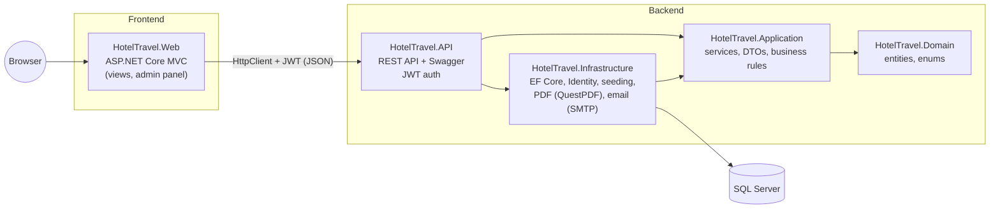
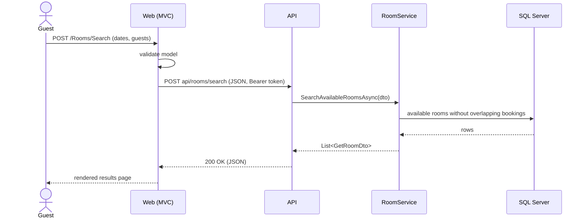
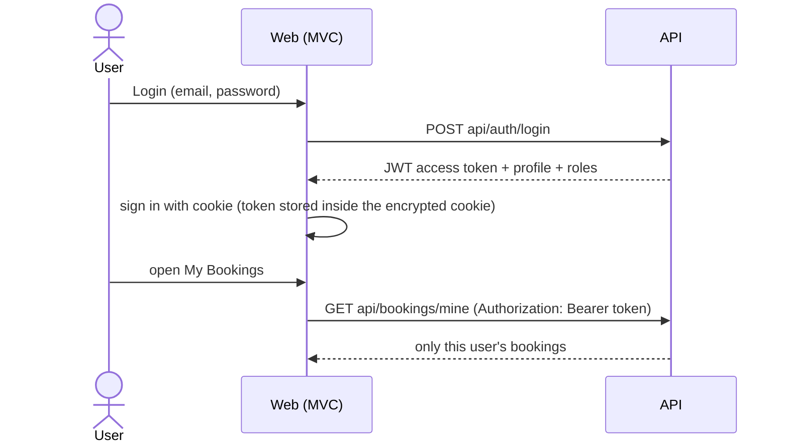
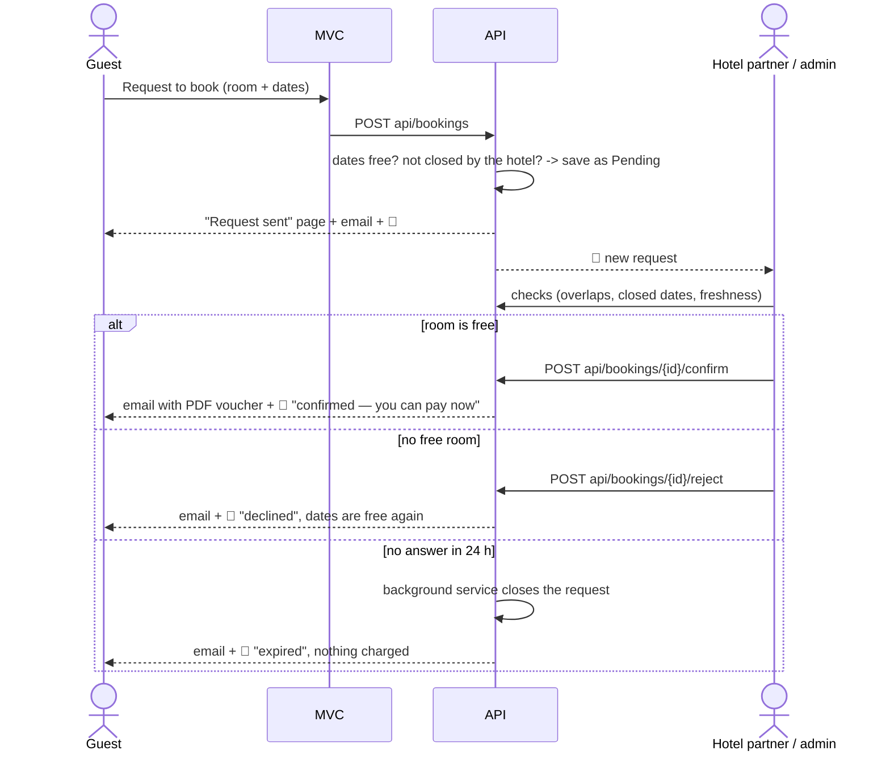
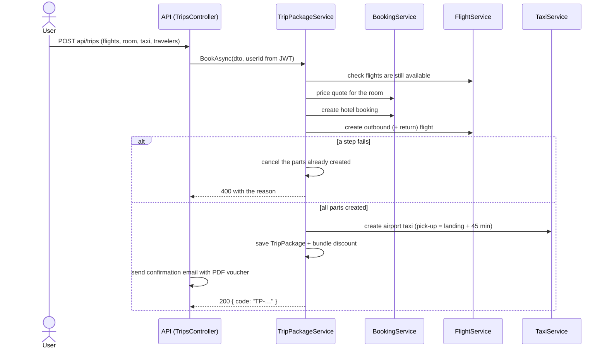

# Tripio — Hotel & Travel Reservation System

[](https://github.com/nigar-aligayeva-code/FinalProject/actions/workflows/ci.yml)


A full-stack booking platform built with **ASP.NET Core 8**: guests search and book hotel rooms,
rent cars, book airport taxis and flights — or all of them together as a **trip package** — find
hotels on a map, explore city attractions and manage everything from one **My Bookings** page. Guests get a
confirmation email with a **PDF voucher**. Admins manage the catalogue and follow the business in an
**analytics** dashboard.

> **Architecture (Variant B):** ASP.NET Core **Web API** backend · ASP.NET Core **MVC** frontend ·
> connected with **HttpClient** · **SQL Server** · documented with **Swagger**.

---

## Architecture

The solution follows **Clean Architecture**. Dependencies point inwards: the domain knows nothing
about the database, the web or the API.



| Project | Responsibility |
|---|---|
| **HotelTravel.Domain** | Entities (`Hotel`, `Room`, `Booking`, `FlightRoute`, `TripPackage`, `EmailLog`, …) and enums. No dependencies. |
| **HotelTravel.Application** | Business logic: services (`BookingService`, `FlightService`, `TripPackageService`, `AnalyticsService`, …), interfaces, DTOs and pure rule classes (`BookingRules`, `PricingCalculator`, `FlightRules`, `TaxiRules`, `TripPackageRules`, `AnalyticsCalculator`). |
| **HotelTravel.Infrastructure** | EF Core `AppDbContext`, migrations, ASP.NET Identity, transactional booking creation, seeders, PDF vouchers (QuestPDF + QR) and email delivery. `AddHotelTravelInfrastructure()` registers everything. |
| **HotelTravel.API** | REST endpoints (~145), JWT authentication, role-based authorization, global exception middleware, Swagger. **Owns the database.** |
| **HotelTravel.Web** | MVC frontend + admin area. **Has no database access**: every service interface is implemented by an HTTP client that calls the API. |
| **HotelTravel.Tests** | 230+ xUnit tests (rules + services with the EF Core InMemory provider), run on every push by GitHub Actions. |

### How a request flows (example: search rooms)



The MVC controllers depend on interfaces such as `IRoomService`. In the API those interfaces are
implemented by the real services (EF Core); in the MVC app they are implemented by
`RoomApiService`, `BookingApiService`, … which call the API through a shared `ApiClient`.
The controllers did not have to change when the data source moved behind the API.

### Authentication



* The API trusts **only the token**: the user id is taken from the JWT, never from the request body.
* Roles: `Admin` and `User`. Admin endpoints use `[Authorize(Roles = "Admin")]`.
* If the token expires, the MVC app signs the user out and redirects to the login page.

---

## Features

**Core (F1–F8)**

1. Hotel & room catalogue with photos, amenities and 360° panorama
2. Availability search by city, dates and guests (fully booked dates are disabled in the calendar)
3. Booking **requests** with an instant code — the hotel confirms within 24 h (see *Real availability* below)
4. Find / modify / cancel a booking by code + email
5. Accounts (register / login) and **My Bookings**
6. Admin panel: hotels, chains, rooms (image upload), amenities, bookings
7. Booking status management + occupancy calendar
8. Concurrency-safe booking (serializable transaction + deadlock retry) — no double booking

**Extra / creative**

* **Flights** — 36 daily routes, local-time arrivals across time zones, dynamic pricing, seat limits
* **Car rental** — fleet per city, availability by dates
* **Airport taxis** — fixed-price transfers, vehicle classes, capacity rules
* **Attractions (city guide)** — sights, tours, food and shopping per city
* **Discounts** — promo codes + 10% "explorer" loyalty discount for guests who stayed in another city
* **Reviews & ratings** (only after a completed stay), **wishlist (Saved)**, **QR voucher**
* One **My Bookings** page for rooms, cars, taxis and flights (upcoming / past & cancelled)

**Added in the final phase**

* **Trip packages** — flight(s) + hotel + airport taxi in one order with a bundle discount
  (8% → 10% with a return flight → 12% with a taxi). Parts are created step by step; if one step
  fails, the parts already created are cancelled (**saga / compensation**), so no half-booked trip remains.
* **PDF voucher & confirmation emails** — A4 voucher with QR code (QuestPDF + QRCoder), emailed on
  booking and cancellation. Without SMTP settings emails are saved as `.eml` files; every email is
  logged and visible in **Admin → Emails**.
* **Admin analytics** — revenue by service and month, revenue split, 30-day occupancy forecast,
  cancellation rate, top cities, most booked rooms, guest ratings (Chart.js).
* **Maps** — all hotels on an OpenStreetMap/Leaflet map; each hotel page shows its location,
  the nearest airport, directions and a one-click airport taxi.
* **User profile** — travel stats and traveler level, edit details, change password,
  **12 illustrated avatars** (or initials).
* **Reports** — admins download bookings, flights, taxis and car rentals as **Excel** (formatted,
  with filters and totals, ClosedXML) or **CSV** (UTF-8, protected against formula injection).
* **Add to calendar** — hotel stays and flights as an `.ics` file or a Google Calendar link.
* **Account security** — "Forgot password" with an emailed one-time link (24 h), account lockout
  after 5 failed logins, and rate limiting (10 auth requests per minute per IP).

**Real availability — how do we know a room is really free?**

A hotel also sells rooms at its reception and on other sites, so our database alone cannot know the
real availability. Tripio therefore never promises "available" — a booking is a **request** that the
hotel confirms:

* **Booking request → hotel confirms.** New bookings are `Pending` (they already hold the dates, so no
  second guest can request the same room). The hotel answers within **24 hours**; unanswered requests
  are closed automatically by a background service and the guest is told (nothing is charged).
* **Hotel partner panel** (`/Partner`, role `HotelPartner`). Hotel staff get their own account and see
  **only their hotel**: confirm / reject requests, **close dates** sold elsewhere (closed rooms disappear
  from search), change prices and press *"I checked — availability is correct"*. The API checks the
  hotel on every call (`PartnerScope`), so a partner can never touch another hotel.
* **Checks before confirming.** For every pending request both the partner and the admin see:
  overlapping Tripio bookings, dates closed by the hotel and how fresh the hotel's data is
  ("checked 2 h ago"). Hotels without a partner are handled by the admin, who calls the hotel
  (phone shown on the request) and closes sold dates in the same panel.
* **Payment only after confirmation** (Stripe test mode), voucher only after confirmation.



**More features**

* **Guest notifications 🔔** — booking requested / confirmed / rejected / cancelled, stored in the
  database (shown later if the guest was offline) and pushed live with SignalR to that user only.
* **Reminders** — email + 🔔 three days and one day before check-in, 24 h and 3 h before a flight
  (background service; each reminder is sent once).
* **Cancellation policy** — free until 3 days before check-in, then 30 %, last 24 h 50 %, no cancellation
  on the check-in day (flights: closed 3 h before departure). The fee is shown before cancelling;
  paid bookings are **refunded automatically** through Stripe minus the fee. Hotel-side cancellations are free.
* **Online payments** — Stripe Checkout in test mode (`sk_test_` keys only).
* **Email verification** — confirmation link, plus a check that the address can receive mail (format,
  disposable domains, MX record).
* **City guide map** — click any attraction for a pop-up with photo, description, address, a map and
  the distance / walking time from your hotel.
* **Room comparison**, **EN / AZ / RU** interface, **dark mode**, **Docker** (one command),
  hotel reviews next to room reviews, photo avatars, country-specific car fleets and room types,
  flights generated automatically between all hotel cities (optional real schedules from AviationStack).

### Trip package flow



---

## Tech stack

ASP.NET Core 8 (Web API + MVC) · Entity Framework Core 8 · SQL Server · ASP.NET Core Identity ·
JWT Bearer · Swagger (Swashbuckle) · SignalR · Stripe.net · QuestPDF · QRCoder · System.Net.Mail · Chart.js ·
Leaflet + OpenStreetMap · xUnit · GitHub Actions · Bootstrap 5 · jQuery · flatpickr

---

## Getting started

**Requirements:** .NET 8 SDK, SQL Server (Express is fine), Visual Studio 2022.

1. Set the connection string in `HotelTravel.API/appsettings.json`
   (`ConnectionStrings:DefaultConnection`).
2. Configure secrets for the API (right-click **HotelTravel.API → Manage User Secrets**):
   ```json
   {
     "Jwt": { "Key": "a-long-random-secret-of-at-least-32-characters" },
     "AdminSettings": { "Email": "admin@example.com", "Password": "Admin123" }
   }
   ```
   (`appsettings.Development.json` already contains a development-only JWT key.)

   *Optional — online payments (Stripe test mode):* create a free account at stripe.com, copy the
   **test** secret key (`sk_test_...`) and add `"Stripe": { "SecretKey": "sk_test_..." }` to the same
   secrets file. Guests then see **Pay now by card** (test card `4242 4242 4242 4242`). Live keys are ignored.

   *Optional — real flight schedules:* get a free key at aviationstack.com and add
   `"AviationStack": { "AccessKey": "..." }`. Admin → Flights → **Import real schedules** then adds real
   flight numbers, airlines and times (one request per airport — the free plan allows 100 per month).
   Without a key, flights between all hotel cities are generated automatically on API start.

   *Optional — real emails:* add an `Email` section to the same secrets file
   (`SmtpHost`, `SmtpPort`, `SmtpUser`, `SmtpPassword`, `From`). Without it, emails are written to
   `HotelTravel.API/App_Data/Emails` as `.eml` files and shown in **Admin → Emails**.
3. Create the database:
   ```
   Update-Database -Project HotelTravel.Infrastructure -StartupProject HotelTravel.API
   ```
4. Start **both** projects: right-click the solution → *Configure Startup Projects* →
   *Multiple startup projects* → `HotelTravel.API` and `HotelTravel.Web` = **Start** (API first).
5. Wait until Swagger opens (the API seeds hotels, rooms, flights, cars and the city guide on first run),
   then use the website.
6. *Hotel partner demo* (Development only) — password **`Partner123`** for all:

   | Account | Hotel |
   |---|---|
   | `partner@tripio.az` | Bosphorus Palace Hotel (Istanbul) |
   | `partner.gabala@tripio.az` | Gabala Mountain Resort |
   | `partner.antalya@tripio.az` | Antalya Blue Resort |
   | `partner.tbilisi@tripio.az` | Tbilisi Heritage Hotel |
   | `partner.batumi@tripio.az` | Batumi Sea View Hotel |
   | `partner.dubai@tripio.az` | Dubai Marina Luxury Hotel |

   The two **Baku** hotels (Caspian Grand, HotelHub Baku) intentionally have **no partner**: their
   requests are handled by the admin, who calls the hotel. Admins manage accounts in **Admin → Hotel partners**.

| App | URL |
|---|---|
| API + Swagger | http://localhost:5152/swagger · https://localhost:7134/swagger |
| Website | http://localhost:5233 |

The MVC app finds the API through `Api:BaseUrl` in `HotelTravel.Web/appsettings.json`.

### Run with Docker (one command)

**Requirements:** Docker Desktop. No .NET SDK or SQL Server needed on the machine.

```bash
docker compose up --build
```

The first build takes a few minutes. Then:

| Service | URL |
|---|---|
| Website | http://localhost:5233 |
| API + Swagger | http://localhost:5152/swagger |
| SQL Server | `localhost,14333` (user `sa`) |

What happens on startup:

1. **sql**: SQL Server 2022 starts. A health check waits until it accepts queries.
2. **api**: applies all EF Core migrations automatically (`Database:MigrateOnStartup=true`),
   seeds roles, the admin user, hotels, rooms, flights, cars and the city guide.
3. **web**: talks to the API inside the Docker network (`Api:BaseUrl=http://api:8080`),
   while the browser uses `Api:PublicUrl=http://localhost:5152` for SignalR and exchange rates.

Passwords come from a `.env` file (copy `.env.example` → `.env`). Without it, demo defaults are used.
Default admin: `admin@tripio.az` / `Admin123!`.

Data is kept in Docker volumes (`sqldata`, `emails`, `uploads`). Stop with `docker compose down`;
add `-v` to also delete the database.

### Using Swagger

1. `POST /api/auth/login` → copy `accessToken`.
2. Click **Authorize**, paste the token (it is kept after a page refresh).
3. Call protected endpoints such as `GET /api/bookings/mine` or admin endpoints.

Every endpoint and section has a description (XML comments), sections start collapsed and there is
a search box to filter endpoints.

### Health & monitoring

* `GET /health` — JSON status of the API and the SQL Server connection (useful for uptime checks).
* Every request is logged with its duration and returns an `X-Response-Time` header;
  requests slower than 500 ms are logged as warnings.

---

## Tests & CI

```
dotnet test
```

230+ tests cover booking rules, pricing and discounts, wishlist, reviews, city guide, car rental,
airport taxis, flights (time zones, dynamic fares, seat limits, cancellation rules), analytics,
profile levels, avatars, email templates (including HTML encoding), trip package rules, payments and
refunds, the booking-request flow (status transitions, expiry), cancellation fees, reminders,
notifications, hotel partner availability (closed dates hide rooms from search) and city guide locations.

**GitHub Actions** (`.github/workflows/ci.yml`) restores, builds the whole solution and runs the
tests on every push and pull request; the badge at the top shows the current status.
