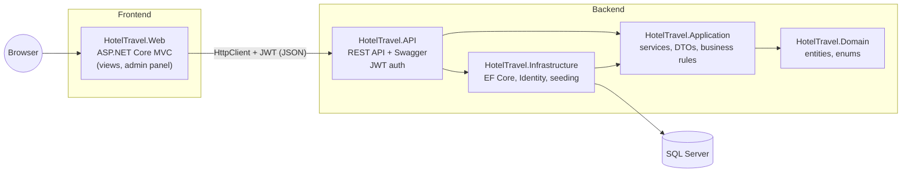
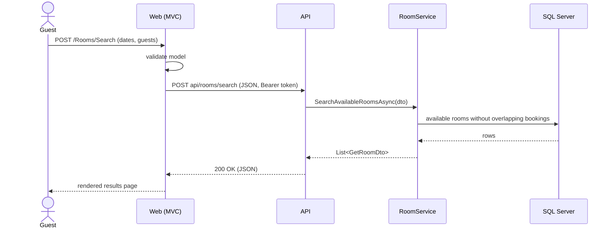
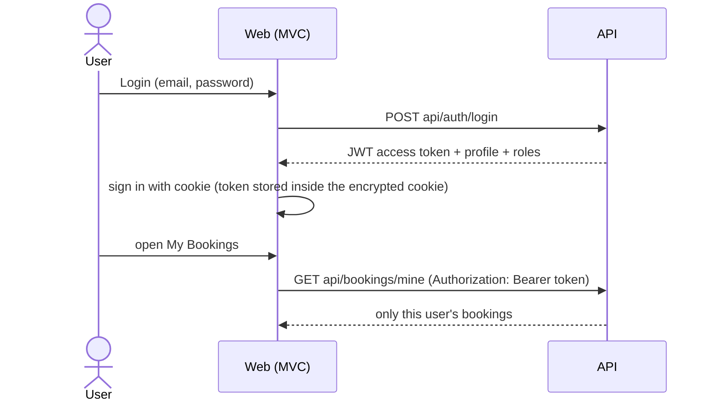

# Tripio — Hotel & Travel Reservation System

A full-stack booking platform built with **ASP.NET Core 8**: guests search and book hotel rooms,
rent cars, book airport taxis and flights, explore city attractions and manage everything from
one **My Bookings** page. Admins manage the whole catalogue from an admin panel.

> **Architecture (Variant B):** ASP.NET Core **Web API** backend · ASP.NET Core **MVC** frontend ·
> connected with **HttpClient** · **SQL Server** · documented with **Swagger**.

---

## Architecture

The solution follows **Clean Architecture**. Dependencies point inwards: the domain knows nothing
about the database, the web or the API.



| Project | Responsibility |
|---|---|
| **HotelTravel.Domain** | Entities (`Hotel`, `Room`, `Booking`, `FlightRoute`, …) and enums. No dependencies. |
| **HotelTravel.Application** | Business logic: services (`BookingService`, `FlightService`, …), interfaces, DTOs and pure rule classes (`BookingRules`, `PricingCalculator`, `FlightRules`, `TaxiRules`). |
| **HotelTravel.Infrastructure** | EF Core `AppDbContext`, migrations, ASP.NET Identity, transactional booking creation, seeders. `AddHotelTravelInfrastructure()` registers everything. |
| **HotelTravel.API** | REST endpoints (~95), JWT authentication, role-based authorization, global exception middleware, Swagger. **Owns the database.** |
| **HotelTravel.Web** | MVC frontend + admin area. **Has no database access**: every service interface is implemented by an HTTP client that calls the API. |
| **HotelTravel.Tests** | 70 xUnit tests (rules + services with the EF Core InMemory provider). |

### How a request flows (example: search rooms)



The MVC controllers depend on interfaces such as `IRoomService`. In the API those interfaces are
implemented by the real services (EF Core); in the MVC app they are implemented by
`RoomApiService`, `BookingApiService`, … which call the API through a shared `ApiClient`.
The controllers did not have to change when the data source moved behind the API.

### Authentication



* The API trusts **only the token**: the user id is taken from the JWT, never from the request body.
* Roles: `Admin` and `User`. Admin endpoints use `[Authorize(Roles = "Admin")]`.
* If the token expires, the MVC app signs the user out and redirects to the login page.

---

## Features

**Core (F1–F8)**

1. Hotel & room catalogue with photos, amenities and 360° panorama
2. Availability search by city, dates and guests (fully booked dates are disabled in the calendar)
3. Booking with an instant confirmation code
4. Find / modify / cancel a booking by code + email
5. Accounts (register / login) and **My Bookings**
6. Admin panel: hotels, chains, rooms (image upload), amenities, bookings
7. Booking status management + occupancy calendar
8. Concurrency-safe booking (serializable transaction + deadlock retry) — no double booking

**Extra / creative**

* **Flights** — 36 daily routes, local-time arrivals across time zones, dynamic pricing, seat limits
* **Car rental** — fleet per city, availability by dates
* **Airport taxis** — fixed-price transfers, vehicle classes, capacity rules
* **Attractions (city guide)** — sights, tours, food and shopping per city
* **Discounts** — promo codes + 10% "explorer" loyalty discount for guests who stayed in another city
* **Reviews & ratings** (only after a completed stay), **wishlist (Saved)**, **QR voucher**
* One **My Bookings** page for rooms, cars, taxis and flights (upcoming / past & cancelled)

---

## Tech stack

ASP.NET Core 8 (Web API + MVC) · Entity Framework Core 8 · SQL Server · ASP.NET Core Identity ·
JWT Bearer · Swagger (Swashbuckle) · xUnit · Bootstrap 5 · jQuery · flatpickr

---

## Getting started

**Requirements:** .NET 8 SDK, SQL Server (Express is fine), Visual Studio 2022.

1. Set the connection string in `HotelTravel.API/appsettings.json`
   (`ConnectionStrings:DefaultConnection`).
2. Configure secrets for the API (right-click **HotelTravel.API → Manage User Secrets**):
   ```json
   {
     "Jwt": { "Key": "a-long-random-secret-of-at-least-32-characters" },
     "AdminSettings": { "Email": "admin@example.com", "Password": "Admin123" }
   }
   ```
   (`appsettings.Development.json` already contains a development-only JWT key.)
3. Create the database:
   ```
   Update-Database -Project HotelTravel.Infrastructure -StartupProject HotelTravel.API
   ```
4. Start **both** projects: right-click the solution → *Configure Startup Projects* →
   *Multiple startup projects* → `HotelTravel.API` and `HotelTravel.Web` = **Start** (API first).
5. Wait until Swagger opens (the API seeds hotels, rooms, flights, cars and the city guide on first run),
   then use the website.

| App | URL |
|---|---|
| API + Swagger | http://localhost:5152/swagger · https://localhost:7134/swagger |
| Website | http://localhost:5233 |

The MVC app finds the API through `Api:BaseUrl` in `HotelTravel.Web/appsettings.json`.

### Using Swagger

1. `POST /api/auth/login` → copy `accessToken`.
2. Click **Authorize**, paste the token.
3. Call protected endpoints such as `GET /api/bookings/mine` or admin endpoints.

---

## Tests

```
dotnet test
```

70 tests cover booking rules, pricing and discounts, wishlist, reviews, city guide, car rental,
airport taxis and flights (time zones, dynamic fares, seat limits, cancellation rules).
